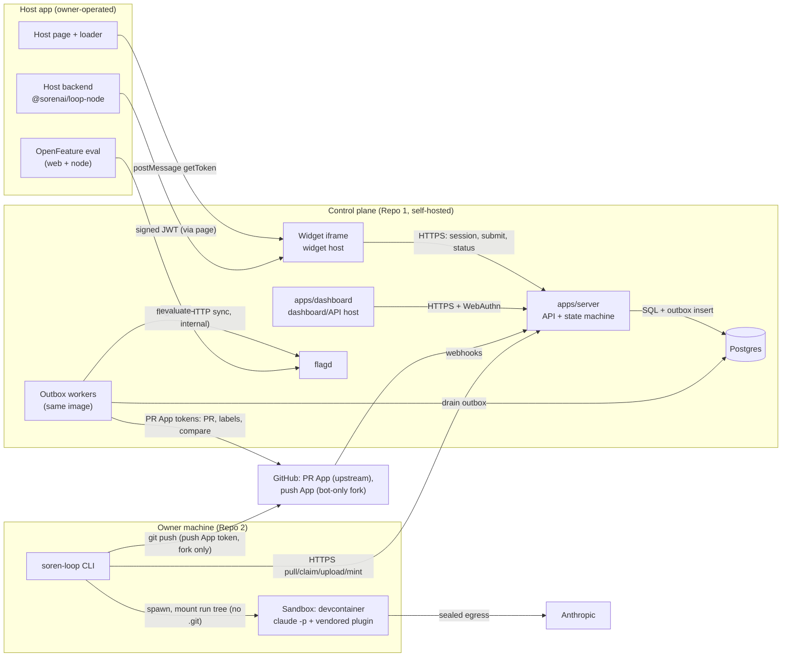
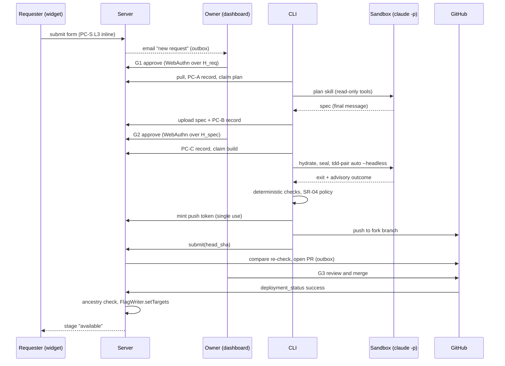

# 02. Architecture: Components, Repo Split, Interactions

## 1. Architecture Overview

There are two network directions that matter for security. The **CLI always initiates** to the
control plane, so nothing on the internet can start a process on the owner's machine. **GitHub
initiates** only signed webhooks. Everything else the control plane does outward (GitHub
writes, flag writes, email) happens in outbox workers, never inline in a request handler.

## 2. Repo Split

The brief's proposal (four repos with flag adapters in the SDK) is superseded by discovery's
corrected split, and decision 10 ratifies the CLI-in-its-own-repo half. Discovery's ADRs don't
argue for anything else, so this RFC adopts: **a control-plane monorepo plus a CLI-and-plugin
repo.** The `/tdd-pair` skill and the Ada and Zod personas live upstream in agent-workflow-kit
and are vendored into Repo 2 (decision 21, SR-20).

| Repo | Packages | Release channel | Why separate |
|------|----------|-----------------|--------------|
| **Repo 1 `sorenai-dev/soren-loop`** (pnpm workspaces, changesets) | `apps/server`, `apps/dashboard`, `packages/widget`, `packages/node`, `packages/react`, `packages/flag-adapters`, `packages/schema` | Signed server image (cosign, SLSA). npm with provenance under the `@sorenai` scope (decision 31; names reserved, SC4): `@sorenai/loop-node`, `@sorenai/loop-react`, `@sorenai/loop-schema`. `packages/flag-adapters` is private (server-only). | Widget, dashboard, and server share schema types constantly |
| **Repo 2 `sorenai-dev/soren-loop-cli`** | `src/` (npm CLI), `plugin/` (Claude Code plugin with the vendored tdd-pair, a soren-loop-owned `plan` skill, and the Ada and Zod agents), `.claude-plugin/marketplace.json` | npm (`soren-loop`) with trusted publishing and provenance; plugin namespace `/soren-loop:*`; marketplace for interactive users only | Different trust boundary (runs next to source and the Claude login), different cadence (tracks Claude Code releases), small auditable dependency tree |
| **Upstream `mandelbro/agent-workflow-kit`** (not ours to change from here) | `assets/skills/tdd-pair/{SKILL.md, outcome.schema.json}`, personas | Vendored by commit SHA plus hashes | Decision 21; PR pending upstream |

Repo 2 depends on Repo 1 only through `@sorenai/loop-schema` (published) and the versioned
`/v1` CLI API.

## 3. Components: What Each Owns and Does NOT Own

### Repo 1

| Component | Owns | Does NOT own |
|-----------|------|--------------|
| `apps/server`: API | Request aggregate and the transition table (`03`); guards; WebAuthn ceremonies and challenge binding; widget JWT exchange; CLI device flow and tokens; push-token minting authority; the PC-S (L3) and PC-I pre-checks; webhook ingestion and dedup; the requester status feed; site configuration (path policy, prod env, origins, JWKS) | Running any agent; holding Claude credentials; deciding eligibility from model output; rendering untrusted HTML; GitHub writes inline in a request (those are outbox effects) |
| `apps/server`: outbox workers (same image, `--role=worker`) | Draining effects idempotently: GitHub issue/PR/label writes, `FlagWriter` calls, email, flag-document rebuild, reminders and timeouts, the PII purge, the reconciler, the SR-23 probe | Deciding transitions. Workers report effect outcomes as events, and the state machine decides. |
| `apps/dashboard` (SPA on the API host) | Owner UI: queues, review aids (SR-22), span highlighting from verified offsets, the hold console (clear, retry, reject), the rollout console, the token and authenticator lists | Any authority of its own. Every mutation is an API call guarded server-side. It never renders model-written strings as HTML. |
| `packages/widget` (loader plus iframe app, served from the widget host) | Launcher, iframe panel, `postMessage` handshake then `MessageChannel`, form intake, chat UI (LLM mode), status feed view; the session token in iframe memory only | Identity (it only relays the host JWT); any owner route; any knowledge of states finer than requester stages |
| `packages/node` | `createWidgetToken(user)` (ES256/EdDSA), `evaluationContext(user)` returning the same ID as `targetingKey` | Flag evaluation (OpenFeature does it); flag writes; any network call to the control plane |
| `packages/react` | `<SorenLoopWidget getToken>`, a hook that wires the OpenFeature context from the same user | A custom flag provider (stock flagd/OFREP providers are used) |
| `packages/flag-adapters` | The `FlagWriter` port; the flagd document renderer; the Unleash adapter (Phase 2); `sl_` namespace enforcement | Choosing who is enabled (the state machine decides); being imported by host apps (server-only package) |
| `packages/schema` | zod schemas for the request, spec envelope, status events, CLI API payloads, the pre-check verdict, and the vendored tdd-pair outcome; JSON Schema export; the normalization and hashing functions shared by server and CLI | Business rules beyond shape (those live in server guards) |
| flagd (third party) | Evaluating flags for host apps from our rendered document | Being a source of truth (Postgres is) |

### Repo 2

| Component | Owns | Does NOT own |
|-----------|------|--------------|
| CLI `login` / `doctor` | Device-flow login (keychain storage); pinning the owner's WebAuthn public keys for receipts (SR-19); environment checks: path policy exists, both Apps' installed permissions match their manifests (the PR App has no `contents` above read; the push App is on the fork only), the fork has no human pushers, `pull_request_target` scan, Docker and image digest, minimum Claude Code version | Claude login (Anthropic's own flow, inside the container) |
| CLI `pull` / `plan` | Fetching approved requests; recomputing `H_req`; exporting `base_sha` from a CLI-owned trusted gitdir into a run directory with no `.git` (SR-28); running PC-A and PC-B; invoking the `plan` skill read-only; uploading the spec plus the PC-B record | Approving anything; fetching request content from GitHub |
| CLI `build` | Verifying `H_spec` (and the receipt); running PC-C; the two-phase sandbox; `claude -p` with SR-01 flags and `/soren-loop:tdd-pair auto --headless`; rate-limit detection from the process; post-run deterministic checks; reporting results | Treating the outcome JSON as authority (SR-18); committing inside the sandbox |
| CLI `submit` | The SR-04 policy (outside the sandbox, no LLM); Conventional Commits; minting a single-use fork push token; push; filling the PR template deterministically; the risk summary | Opening the PR (the server does it, after re-checking the diff); merging |
| Plugin (vendored) | tdd-pair (headless), Ada and Zod personas, the `plan` skill, `VENDORED.json` | Being fetched or updated at runtime |
| Sandbox image | Reference-devcontainer-derived image pinned by digest; firewall phases; non-root agent user | Network policy decisions at runtime (fixed by the CLI per phase) |

## 4. Interactions

| # | From → To | Sync / async | Data | Initiator |
|---|-----------|--------------|------|-----------|
| I1 | Host page → widget iframe | Sync (`postMessage`, then `MessageChannel`) | Host JWT on request | Widget asks; host page answers |
| I2 | Widget → API `POST /v1/widget/sessions` | Sync | Host JWT → session token bound to `(site_id, sub)` | Widget |
| I3 | Widget → API `POST /v1/widget/requests` | Sync, with an async tail | Form fields or a chat draft ID; PC-S runs inline; PC-I is queued | Requester |
| I4 | Widget → API `GET /v1/widget/requests/{id}` | Sync poll (30 s; SSE later) | Requester stage, owner-authored question if any | Widget |
| I5 | API → host JWKS URL | Async (cached, refreshed) | JWKS | Server, under the SSRF defense |
| I6 | API → DB | Sync, one transaction per transition | State, revision, transition row, outbox rows | Server |
| I7 | Workers → GitHub | Async (outbox) | Issue projection, PR open, labels, compare calls | Worker |
| I8 | GitHub → API `/v1/webhooks/github` | Async inbound | `pull_request`, `pull_request_review`, `deployment_status`, `installation` | GitHub |
| I9 | Workers → SMTP | Async (outbox) | Fixed-subject plain-text notification plus one link | Worker |
| I10 | Owner browser → API | Sync | Session; WebAuthn options and assertions bound to content hashes | Owner |
| I11 | CLI → API | Sync (pull model) | List and fetch approved work; claim with lease; heartbeat; upload spec and pre-check records; report run results; mint push token; submit | CLI (owner command) |
| I12 | CLI → sandbox | Local, sync | Worktree mount; Claude auth variable only; the phase flag | CLI |
| I13 | Sandbox → Anthropic | Sync (model traffic) | Prompts and file contents | `claude -p` |
| I14 | CLI → fork | Sync (`git push`) | Commits on `soren-loop/<public_ref>` | CLI, with a token minted at I11 |
| I15 | Workers → flagd | Async: flagd polls the internal sync endpoint (gRPC push later) | Rendered flag document | flagd (pull) |
| I16 | Host eval → flagd | Sync | Evaluation by `targetingKey` | Host app |
| I17 | Workers → Unleash (Phase 2) | Async (outbox) | Admin API calls via `FlagWriter` | Worker |
| I18 | Policy-diff job → Anthropic pages, GitHub Issues | Async (weekly cron) | Normalized page text; issue on change | GitHub Actions in Repo 1 |

## 5. Happy-Path Sequence (MVP)

## 6. Existing Components and Reuse Plan

Greenfield. The reuse is of third-party and OSS components, from `01-discovery.md` §Reuse, with
the decisions taken since then applied.

| Need | Reuse | Extend / adapt | Deliberately not reused |
|------|-------|----------------|-------------------------|
| Agent execution | Stock `claude -p --output-format stream-json` | SR-01 flag set; zod-validated stream parser | Agent SDK on subscription (not permitted); custom harness |
| TDD engine | agent-workflow-kit tdd-pair, headless mode, outcome schema v1 | Vendored at a SHA; TS validator mirrors the Python cross-field rules (`15` §4) | A rewritten engine |
| Personas | agent-workflow-kit Ada and Zod (Apache-2.0) | Vendored, hash-verified | Private persona files |
| Flag evaluation | OpenFeature web/node SDKs, flagd providers, OFREP | `packages/node`/`react` set `targetingKey` | A custom provider |
| Flag store | flagd | Our server renders its document | Our own evaluator |
| GitHub | Two GitHub Apps (decision 25), `@octokit/app`, `@octokit/webhooks` | Per-operation down-scoped installation tokens; separate signer per App | Fine-grained PATs; a single App (S1 F2) |
| Sandbox | Anthropic reference devcontainer and its firewall script | Phase A/B firewall switch; non-root; capabilities dropped | Building an image from scratch |
| Queue | pg-boss or graphile-worker (**UNVERIFIED** maintenance status; pick in Phase 1 week 1) | Outbox drain, timers | Temporal, Inngest |
| WebAuthn | SimpleWebAuthn | Content-derived challenges | Hand-rolled CBOR/COSE |
| JWT | `jose` | Algorithm allowlist, `jti` cache | HMAC user-hash |
| Email | Nodemailer behind `Notifier` | Plain-text templates | Vendor SDKs |

Rule of Three: `FlagWriter` (flagd, Unleash, LaunchDarkly) and `Runner` (CLI, Action) earn ports
now. `Notifier` stays one implementation behind a thin interface.

## 7. Integration Requirements

**Data in:**

| Data | From | Enters at |
|------|------|-----------|
| Requester identity (`sub`, display name) | Host backend JWT | I2 |
| Request text | Requester | I3 |
| Repo conventions (PR template, CONTRIBUTING, `CLAUDE.md`, `AGENTS.md`, CODEOWNERS, `git log` subjects) | Local checkout | CLI `plan`, `build`, `submit` |
| Owner passkeys | Dashboard enrollment | I10 |
| Claude login | Owner, through Anthropic's flow inside the container | I12/I13 |
| PR and deployment events | GitHub webhooks | I8 |
| Vendor credentials (Phase 2) | Owner config, envelope-encrypted | I17 |

**Data out:**

| Data | To |
|------|----|
| Approved request and spec, with hashes and receipts | CLI |
| PR (from the fork) with flag key, `public_ref` (never the widget `request_id`, SR-40a), risk summary | Owner review on GitHub |
| Optional issue projection (ID plus owner-edited title) | GitHub |
| Flag document / vendor targeting | flagd / Unleash, then host evaluation |
| Requester stage events | Widget feed |
| Owner notifications | Email |

**End-to-end smoke test** (discovery's, with the ratified changes applied): in the bundled demo
app (private repo), user `u_123` submits "a dark mode toggle on the settings page" through the
form. The request lands in `submitted` with PC-S clean. The owner approves G1 with a passkey;
the server mints `sl_<random>`. `soren-loop plan <id>` produces a spec and the owner approves
G2. `soren-loop build <id>` runs headless tdd-pair in the sealed sandbox. `soren-loop
submit <id>` passes SR-04, pushes to the bot fork, and the server opens an upstream PR that
fills the repo's template and gates the toggle behind the flag. The owner merges. The demo's
deploy workflow posts `deployment_status: success` for `production`. The server verifies
ancestry and renders `targetingKey in ["u_123"]` into the flagd document. `u_123` reloads and
sees the toggle; `u_456` does not. `u_123`'s widget shows **available**. In the same run, a
second request containing a bidi override never reaches G1: it sits in `security_hold` while
its requester sees **received** (ST-39, ST-33).
