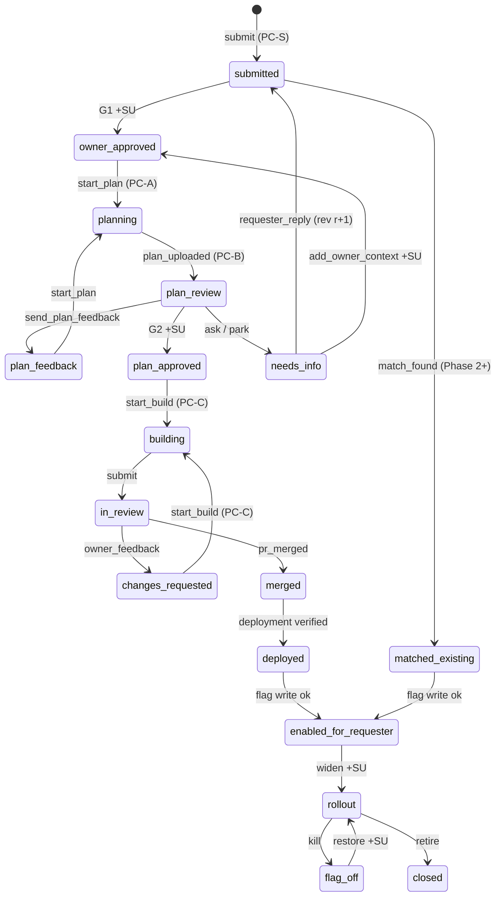
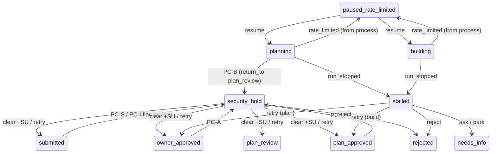

# 03. The Request State Machine

The request is a long-lived aggregate with five external actors. The transition map is data,
a table of `(from, event, guard, to, effects)` in `apps/server`. One function applies it inside
one Postgres transaction: check `version`, evaluate the guard, write the new state and
`state_ctx`, append to `request_transitions`, and insert outbox rows. Nothing else writes
`requests.state` (ST-23).

## 1. Principles

1. **Model output can stop a request, never advance it** (SR-18). A run that ends badly moves
   the request to `stalled`. Every forward move comes from a deterministic check, an owner
   action, or a verified external event.
2. **Holds return to where they came from**, and every later gate still applies (`03` §7.4 of
   the threat model). A clearance binds one content hash and one L2 fingerprint.
3. **Requester stages are a projection.** Requester events are emitted only when the
   *requester stage* changes, never on internal transitions (§5). That is how a hold stays
   invisible.
4. **CLI events are claims about the owner's machine**, accepted only under guards the server
   can check: the token's scope, the lease, hash equality, and the presence of a pre-check
   record (ST-34). A modified CLI can still lie about local facts. That residual is accepted
   (PC7).

## 2. States

| State | Kind | Meaning | `state_ctx` fields |
|-------|------|---------|--------------------|
| `intake` | Pre-request | LLM-mode chat draft only. Form mode has no server-side intake state. | `session_id`, turn count |
| `submitted` | Waiting (owner) | Revision `r` stored, PC-S done, awaiting G1 | `rev`, `h_req` |
| `security_hold` | Waiting (owner) | A pre-check flagged, or could not run | `checkpoint` (PC-S/I/A/B/C), `reason` (`flagged` / `precheck_unavailable`), `verdict_id`, `content_hash`, `l2_fingerprint`, `return_to` |
| `owner_approved` | Waiting (owner CLI) | G1 passed for `h_req`; flag key minted | `h_req`, `approval_id` |
| `planning` | Running (CLI) | A CLI holds the plan lease | `lease_id`, `lease_expires_at`, `base_sha` |
| `plan_review` | Waiting (owner) | Spec uploaded, PC-B clean or cleared, awaiting G2 | `spec_id`, `h_spec` |
| `plan_feedback` | Waiting (owner CLI) | The owner returned the spec with feedback; re-plan next | `feedback_id` |
| `needs_info` | Waiting (owner or requester) | Information is missing | `from` (`owner` / `requester`), `question_id`, `deadline` |
| `plan_approved` | Waiting (owner CLI) | G2 passed for `h_spec`; awaiting an owner-started `build` | `h_spec`, `approval_id` |
| `building` | Running or ready | `running`: a CLI holds the build lease. `ready`: deterministic checks passed; awaiting `submit`. | `sub` (`running` / `ready`), `lease_id`, `base_sha`, `run_id`, `rework_of` |
| `paused_rate_limited` | Waiting (owner CLI) | The CLI saw a rate limit from the `claude` process | `resume_to` (`planning` / `building`), `resets_at`, `run_id` |
| `stalled` | Waiting (owner) | A run ended without a deterministic success: process error, failed checks, lease lost, or an advisory `blocked`/`needs_info` outcome | `phase` (`plan` / `build`), `reason`, `advisory` (validated outcome summary, untrusted) |
| `in_review` | Waiting (owner on GitHub) | Upstream PR open | `pr_number`, `head_sha` |
| `changes_requested` | Waiting (owner CLI) | Owner-authored rework feedback recorded | `feedback_id` |
| `merged` | Waiting (deploy) | PR merged upstream | `merge_sha` |
| `deployed` | Transient | A verified deploy contains `merge_sha`; the flag write is queued | `deploy_id` |
| `enabled_for_requester` | Live | The flag is on for the requester's `sub` | `flag_id` |
| `rollout_targeted` | Live | On for an owner-chosen list of `sub`s (capped at 500) | `targets_count` |
| `rollout_percentage` | Live (Phase 2) | On for `pct`% via flagd `fractional` | `pct` |
| `rollout_all` | Live | On for everyone | |
| `flag_off` | Live (killed) | The owner turned the flag off; reversible | `previous` |
| `matched_existing` | Waiting (Phase 2+) | The matcher picked a self-serve flag from an enum | `flag_id`, `needs_owner_confirm` |
| `rejected` | Terminal | Owner rejected | `reason` (owner-only) |
| `closed` | Terminal | `withdrawn`, `no_response`, `pr_closed`, `shipped` | `reason` |

## 3. Transition Table

Actors: **Rq** requester (widget session), **Ow** owner (dashboard session; **+SU** means a
WebAuthn step-up bound to the content shown), **CLI** the CLI on behalf of the owner (token
scoped to the site), **GH** a verified GitHub webhook, **Sys** a worker or timer.

| # | From | Event | Guard | To | Effects (outbox unless noted) | Actor |
|---|------|-------|-------|----|-------------------------------|-------|
| 1 | — / `intake` | `submit` | Session valid for `(site, sub)`; SR-11 caps; requester not throttled; field caps; intake not paused | `submitted`, or `security_hold{PC-S, return_to: submitted}` if L3 hits | Normalize, store rev 1, compute `h_req`; **L3 inline** (PC-S, A23-1); owner email (digested); enqueue PC-I if LLM mode; enqueue matcher (Phase 2+) | Rq |
| 2 | `submitted` | `precheck_result{PC-I}` | Record matches the current `h_req` | Stays `submitted` if clean; `security_hold{PC-I, return_to: submitted}` if flagged or unavailable | Store record; on a hold, increment the requester flag counter | Sys |
| 3 | `submitted` | `approve_request` (G1) | +SU over `H(approve_request‖req‖h_req‖nonce)`; PC-S record for `h_req`; PC-I record if LLM mode; owner chose the eligibility class | `owner_approved` | Store receipt; mint `sl_<random>`; `FlagWriter.ensureFlag(off)`; issue projection if enabled (SR-17) | Ow |
| 4 | `submitted`, `owner_approved`, `plan_review`, `plan_feedback`, `plan_approved`, `needs_info`, `stalled`, `changes_requested`, `security_hold` | `reject` | Owner session (no step-up: rejecting only stops) | `rejected` | Close the projection; set `purge_after = now + 90d` | Ow |
| 5 | `owner_approved`, `plan_feedback` | `precheck_reported{PC-A}` | CLI token for site; record over `h_req` (+ feedback hash) and `base_sha` | Same state if clean; `security_hold{PC-A, return_to: <from>}` otherwise | Store record | CLI |
| 6 | `owner_approved`, `plan_feedback` | `start_plan` | CLI-sent `h_req` equals the server's; clean or cleared PC-A record for `(h_req, base_sha)`; no live lease | `planning` | Issue a lease (15 min, heartbeat 60 s) | CLI |
| 7 | `planning` | `plan_uploaded` | Lease holder; spec envelope schema-valid; size cap; spec `parent = h_req`; PC-B record over `(h_req, h_spec)` | `plan_review` if PC-B clean; `security_hold{PC-B, return_to: plan_review}` otherwise | Store spec; compute review aids (SR-22); owner email | CLI |
| 8 | `planning`, `building{running}` | `rate_limited{resets_at}` | Lease holder; detected by the CLI from the process, never from the outcome JSON | `paused_rate_limited{resume_to}` | Release the lease; owner email with `resets_at` | CLI |
| 9 | `paused_rate_limited` | `resume` | CLI token; same `run_id`; for `building`, PC-C L2 re-run on the preserved run tree's base | `resume_to` (lease re-issued) | — | CLI |
| 10 | `planning`, `building{running}` | `run_stopped{reason}` | Lease holder; or `Sys` on lease expiry | `stalled{phase, reason, advisory}` | Owner email | CLI / Sys |
| 11 | `building{running}` | `build_checks_passed` | Lease holder; deterministic results (tests, lint, typecheck, SR-04 local pass) attached; outcome may be absent or say anything | `building{ready}` | Release the lease | CLI |
| 12 | `stalled` | `retry` | Owner session | `owner_approved` (phase `plan`) or `plan_approved` (phase `build`) | — | Ow |
| 13 | `plan_review`, `stalled`, `changes_requested` | `ask_requester{question}` | Owner-authored text, ≤ 500 chars, SR-06 checks | `needs_info{from: requester}` | Requester stage → `needs_your_input`; deadline timer (14 d) | Ow |
| 14 | `plan_review`, `stalled` | `park_for_owner_context` | Owner session | `needs_info{from: owner}` | — | Ow |
| 15 | `needs_info{from: requester}` | `requester_reply` | Same `(site, sub)`; caps | `submitted` (rev `r+1`) or `security_hold{PC-S, return_to: submitted}` | New `h_req'`; L3 inline; the G1 view shows the rev diff | Rq |
| 16 | `needs_info{from: owner}` | `add_owner_context` (G1′) | +SU over `H(approve_request‖req‖h_req'‖nonce)` | `owner_approved` | Rev `r+1` with `owner_context`; receipt | Ow |
| 17 | `needs_info{from: requester}` | `info_timeout` | Deadline passed | `closed{no_response}` | Purge timer | Sys |
| 18 | `plan_review` | `approve_spec` (G2) | +SU over `H(approve_spec‖req‖h_spec‖nonce)`; `spec.parent = current h_req`; PC-B record for `h_spec` clean or cleared; paths named in the spec inside the policy | `plan_approved` | Store receipt | Ow |
| 19 | `plan_review` | `send_plan_feedback` | Owner-authored; size cap | `plan_feedback` | Store feedback with `h_fb` | Ow |
| 20 | `plan_approved`, `changes_requested` | `precheck_reported{PC-C}` | Record verifies the PC-B record against `h_spec`; L2 re-run against the actual `base_sha` | Same state if clean or covered by a clearance; `security_hold{PC-C, return_to: <from>}` otherwise | Store record | CLI |
| 21 | `plan_approved`, `changes_requested` | `start_build` | CLI-sent `h_spec` equals the server's; receipt verified by the CLI (SR-19, MUST); PC-C record for this `base_sha`; `doctor` attests a path policy exists; no live lease | `building{running}` | Lease; `rework_of = feedback_id` when coming from `changes_requested` | CLI |
| 22 | `building{ready}` | `mint_push_token` (not a transition) | State and `h_spec` match; one mint per `run_id` | — | Single-use push App token for the fork only, 1 h; any non-201 mint is a hard error (S1 F3); audit row | CLI |
| 23 | `building{ready}` | `submit{head_sha}` | Push token was used; the server's compare re-check of `fork:branch` vs `base_sha` passes the server-checkable SR-04 rules (deny-list, manifests, size, binaries) | `in_review` (after the PR-open effect succeeds) | Open the upstream PR with the PR App (`maintainer_can_modify: false`, S1 F4), a deterministic body and risk summary; label | CLI → Sys |
| 24 | `in_review` | `owner_feedback` | From the dashboard, or a `pull_request_review` with `changes_requested` by the configured owner login only (T10.9) | `changes_requested` | Store feedback with `h_fb` | Ow / GH |
| 25 | `in_review`, `changes_requested` | `pr_merged` | Webhook verified and deduped; PR number and head repo match the bot fork | `merged` | Record `merge_sha`; deploy-wait alert timer (7 d) | GH |
| 26 | `in_review`, `changes_requested` | `pr_closed_unmerged` | As above | `closed{pr_closed}` | Purge timer | GH |
| 27 | `merged` | `deployment_succeeded{env, sha}` | `env` = the site's prod env; compare(`merge_sha`, `sha`) is `ahead` or `identical`; delivery not seen. Also from the signed deploy webhook, or `mark-deployed` (owner CLI, audited). | `deployed` | `FlagWriter.setTargets(flag_key, [sub])` | GH / Sys / CLI |
| 28 | `deployed`, `matched_existing` | `flag_write_succeeded` | Effect ID matches | `enabled_for_requester` | Requester stage → `available`; SR-23 probe (SHOULD) | Sys |
| 29 | Live states | `widen_rollout{targets / pct / all}` | +SU over `H(widen_rollout‖req‖target_digest‖nonce)` | `rollout_targeted` / `rollout_percentage` / `rollout_all` | `FlagWriter` call | Ow |
| 30 | Live states | `kill_flag` | Owner session (no step-up: the safe direction) | `flag_off{previous}` | `FlagWriter.disable` | Ow |
| 31 | `flag_off` | `restore_flag` | +SU | `previous` | `FlagWriter` replay | Ow |
| 32 | `rollout_all` | `retire` | Owner session | `closed{shipped}` | Purge timer | Ow |
| 33 | Any non-terminal state | `withdraw` | Same `(site, sub)` | `closed{withdrawn}` | Leases revoked; purge timer | Rq |
| 34 | `security_hold{reason: flagged}` | `clear_hold` | +SU over `H(clear_hold‖req‖verdict_id‖content_hash‖nonce)`; no bulk | `return_to` | Clearance row covering `(content_hash, l2_fingerprint)` | Ow |
| 35 | `security_hold{reason: precheck_unavailable}` | `retry_precheck` | Owner session; Clear is **not** offered | `return_to` (record invalidated; PC-I re-queued server-side; CLI checkpoints re-run on the next command) | — | Ow |
| 36 | `submitted` | `match_found` (Phase 2+) | Selection is from the site's self-serve enum (SR-32) | `matched_existing` | If no owner confirm is needed: `FlagWriter.setTargets` | Sys |
| 37 | `matched_existing` | `confirm_match` | +SU (SR-32) | stays (effect queued) | `FlagWriter.setTargets` | Ow |

"Owner email" and "requester stage →" effects are notification events resolved by the decision 30
policy inside the same transaction (`14` §1). The policy can route or suppress them, but never
records them as anything other than `suppressed`.

Any `(from, event)` pair not in the table returns `409 invalid_transition` and writes nothing.
That includes every event on `rejected` and `closed`.

**Throttle (A23-8).** Each hold whose checkpoint is requester-originated (PC-S, PC-I, PC-A,
PC-B) increments `requesters.flag_count_24h`. At the site threshold (default 3), the requester
is paused. A pause is **shadow-accept** (SR-40b, ST-62). New submissions are stored and shown
to the requester as `received`, exactly like normal ones. They're marked `throttled`, grouped
separately in the owner queue (bulk reject is available), count toward the ordinary SR-11 open
and daily caps, and send no owner notification beyond the single `owner.requester_throttled`
notice. Returning `limit_reached` instead would leak: a requester with no open requests under
the daily cap could infer they had been flagged at least three times.
Throttled submissions run PC-S (L3: deterministic and free) as usual. They **skip PC-I and the
matcher** (Phase 2+), so the owner doesn't spend API money on a requester already flagged as
abusive (AB1, LLM10). Skipping leaks nothing, because PC-I results are never visible to the
requester. G1 requires a PC-I record in LLM mode (row 3), so an owner who un-throttles a
submission triggers PC-I at that point. Intake chat stays unchanged, under the per-user SR-11
caps, because changing the UI for a throttled requester would itself leak.

**Clearances and L2 at build start.** PC-C re-runs L2 against the base it will actually build
on. A clearance covers the exact `(content_hash, l2_fingerprint)`, where the fingerprint is a
hash over the instruction-file diff between the trusted commit and `base_sha`. The same diff
after a clear doesn't re-hold. A new diff does (ST-31, ST-40).

## 4. Diagrams

Main lifecycle (holds, pauses, and the stall and reject edges are in the second diagram):

Holds, pauses, and stalls overlay the lifecycle. Each returns to its origin:

## 5. Requester-Visible Stage Mapping

| Requester stage | Internal states | Notes |
|-----------------|-----------------|-------|
| `received` | `submitted`, `matched_existing`, `security_hold` with `return_to: submitted` | A match stays hidden until enabled (T12.3) |
| `needs_your_input` | `needs_info{from: requester}` | The only stage that carries text: the owner-authored question |
| `planning` | `owner_approved`, `planning`, `plan_review`, `plan_feedback`, `needs_info{from: owner}`, `plan_approved`, `paused_rate_limited{resume_to: planning}`, `stalled{phase: plan}`, `security_hold` with `return_to` ∈ {`owner_approved`, `plan_feedback`, `plan_review`, `plan_approved`} | PC-A, PC-B, and PC-C holds all sit inside this stage |
| `building` | `building`, `paused_rate_limited{resume_to: building}`, `stalled{phase: build}`, `in_review`, `changes_requested`, `security_hold{return_to: changes_requested}` | |
| `shipping` | `merged`, `deployed` | |
| `available` | `enabled_for_requester`, `rollout_*` | The requester stays targeted through widening |
| `closed` | `rejected`, `closed{*}`, `flag_off` | A rejection after a hold looks like any other rejection |

Rules that make a hold indistinguishable (A23-5, ST-33):

- Requester events are emitted **only on a change of requester stage**. The brief's "every
  transition emits a coarse status event" is implemented as "every transition is evaluated,
  and an event is emitted when the projected stage changes" (`13` T1). Pushed notifications follow the same rule ([`14`](14-notifications.md)).
- The feed exposes `stage` and `stage_since`. `stage_since` is rounded to the hour by default
  (T12.2), so time spent in a hold and time spent waiting on the owner look the same.
- No requester notification is ever sent on entering or leaving a hold. The notification policy
  enforces this by construction: it only sees requester-stage changes (`14` §3).
- Every PC-C hold happens before `building`, so it never pulls a request back out of the
  `building` stage. PC-C on rework (`changes_requested`) holds inside `building`, where the
  request already is.

`flag_off` maps to `closed` rather than inventing a "paused" stage. A requester whose feature
disappears gets a clear signal, and the owner decides the copy (decision 29, Q9).

## 6. Invariants (ST-23 property tests)

Random event sequences over the table, run against a real Postgres in CI, must never:

1. reach a state not in §2;
2. reach `building` without G1 for the current `h_req`, G2 for an `h_spec` whose parent is that
   `h_req`, and a PC-C record for the exact `(h_spec, base_sha)`;
3. leave `security_hold` toward any state except through `clear_hold` (+SU), `retry_precheck`
   (for `precheck_unavailable` only), or `reject`;
4. let one clearance cover a different `content_hash` or `l2_fingerprint`;
5. advance on any event whose only evidence is model output (`stalled` is the only state a
   model-reported status can lead to);
6. emit a requester event for a transition that doesn't change the requester stage;
7. mint a second push token for one `run_id`, or any token outside `building{ready}`;
8. enable a flag for anyone but the request's `sub` without a +SU `widen_rollout` row.

Concurrency: every transition is `UPDATE ... WHERE id = $1 AND version = $2`. A losing writer
gets `409 version_conflict` with `suggested_action: refetch`. Webhooks and CLI retries carry
idempotency keys (`05` §3), so a retried event is a no-op instead of a second transition.
