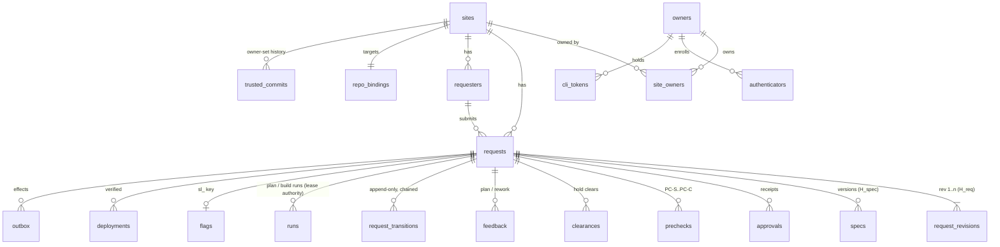

# 04. Data Model

Postgres 16+. Every table carries `site_id` (the tenancy seam for RLS later, SR-34), and every
repository-layer query is scoped by it (T4.4). IDs are typed-prefix strings with 128 bits of
randomness (`req_`, `ref_`, `rev_`, `spec_`, `apr_`, `pck_`, `clr_`, `fb_`, `q_`, `sl_`,
`tok_`, `run_`, `dep_`, `obx_`, `site_`, `own_`, `trc_`). They are never sequential (AB6,
SR-12). Approval receipts and retention are in `17-receipts-and-retention.md`.

## 1. Entity-Relationship Diagram



## 2. Tables

### Configuration and identity

| Table | Key columns | Notes |
|-------|-------------|-------|
| `sites` | `id`, `name`, `widget_origins text[]`, `jwks_url`, `jwks_cache jsonb`, `intake_mode` (`form`/`llm`), `intake_key_enc bytea`, `path_policy jsonb`, `path_policy_confirmed_approval_id`, `prod_environment`, `issue_projection bool`, `enablement_mode` (`auto`/`merger_must_be_owner_login`/`dashboard_confirm`, decision 29 Q2), `requester_email_enabled bool` (default false, T17), `caps jsonb`, `flag_throttle int`, `intake_paused bool`, `config_version int` | Every security-relevant change is +SU over `sl:site_config:v1` (§3) and bumps `config_version` |
| `site_owners` | `site_id`, `owner_id`, `role` (`owner`; more roles are post-V1) | Gives the `site_id` seam an owner link (Zod m11) |
| `repo_bindings` | `site_id`, `pr_app_id`, `pr_app_installation_id`, `push_app_id`, `push_app_installation_id`, `bot_owner_login`, `upstream_full_name`, `fork_full_name`, `default_branch`, `owner_github_login`, `same_repo_mode bool` | Two Apps (decision 25). `same_repo_mode` is the opt-in path from decision 29 Q1 (`08` §1.8). Private keys never live here. |
| `trusted_commits` | `site_id`, `sha`, `set_by_approval_id`, `created_at` | Append-only and chained. The latest row is current. Never written by a merge or a bot (A23-6). |
| `owners` | `id`, `email`, `display_name`, `contact_version` | Email changes are +SU and notify the old address (`14` §4.1) |
| `authenticators` | `owner_id`, `credential_id`, `public_key_cose`, `sign_count`, `transports`, `backup_eligible`, `created_at`, `revoked_at` | Two, or one plus recovery codes (R12). Add and remove are +SU and chained. |
| `recovery_codes` | `owner_id`, `code_hmac`, `used_at` | Peppered HMAC |
| `owner_sessions` | `id_hmac`, `owner_id`, `created_at`, `expires_at` | `__Host-` cookie, rotated on login and step-up. There is no "stepped up" window (SR-35). |
| `cli_tokens` | `id`, `owner_id`, `site_id`, `family_id`, `access_hmac`, `refresh_hmac`, `device_label`, `last_ip`, `expires_at`, `revoked_at` | `family_id` is also the CLI idempotency principal (§5) |
| `requesters` | `id`, `site_id`, `sub` (PII), `display_name` (PII), `email_enc` (PII; only from a host claim with `email_verified: true`), `paused_until`, `blocked` | `(site_id, sub)` unique. The flag count is **derived** from `prechecks` (Zod M3), so there's no counter column. |

### The request aggregate

| Table | Key columns | Notes |
|-------|-------------|-------|
| `requests` | `id`, `public_ref` (`ref_…`, the only ID GitHub artifacts carry, SR-40a), `site_id`, `requester_id`, `state`, `state_ctx jsonb`, `version int`, `current_rev`, `h_req_current`, `h_spec_current`, `eligibility_class` (set at G1, bound by `sl:g1:v1`), `throttled bool`, `flag_id`, `pr_number`, `merge_sha`, `created_at`, `closed_at`, `purge_after`, `text_purge_after` | The only row the state machine mutates. `state_ctx` is validated by a per-state zod schema and never holds lease data (`runs` is the authority). |
| `request_revisions` | `id`, `request_id`, `rev`, `kind` (`requester`/`owner_context`), `fields jsonb` (the closed `sl.request.v1` object, §3), `stripped jsonb`, `h_req`, `parent_h_req` | Immutable. Each revision is **cumulative**: an `owner_context` revision copies the requester fields and sets `owner_context`. |
| `specs` | `id`, `request_id`, `version`, `envelope jsonb` (`{body_md, paths[]}`, §3), `h_spec`, `parent_h_req`, `h_fb`, `base_sha`, `uploaded_by_run`, `review_aids jsonb` | Immutable. Never projected to GitHub. `paths[]` is what the G2 policy guard checks (Zod M8). |
| `feedback` | `id`, `request_id`, `kind` (`plan`/`rework`), `body`, `h_fb`, `author` (`owner`/`owner_github_review`), `approval_id` (rework: +SU, `03` row 24) | Owner-authored only (T10.9) |
| `questions` | `id`, `request_id`, `body`, `asked_by`, `answered_rev` | Owner-authored |
| `runs` | `id`, `request_id`, `phase` (`plan`/`build`), `mode` (`headless`/`interactive`), `lease_id`, `lease_expires_at`, `cancel_requested bool`, `cli_token_id`, `base_sha`, `tree_source` (`base`/`pr_head`), `tree_head_sha`, `claude_version`, `result jsonb`, `advisory jsonb` (untrusted), `push_token_id`, `push_mints int` (≤ 2), `submit_attempt int`, `ended_at`, `end_reason` | **The lease authority** (Zod m11, Postel M9) |
| `prechecks` | `id`, `request_id`, `checkpoint`, `content_hash`, `base_sha`, `trusted_sha`, `l1`, `l2` (`fingerprint`, paths), `l3`, `verdict` (`clean`/`flagged`/`unavailable`), `flag_layers text[]`, `categories text[]`, `spans` (offsets only), `requester_attributable bool`, `ran_on`, `cli_token_id`, `created_at` | `requester_attributable` = flagged by L1 or L3 over requester content. Only those rows count toward the throttle. |
| `clearances` | `id`, `request_id`, `verdict_id`, `content_hash`, `l2_fingerprint`, `approval_id`, `created_at` | Zod M15. Bound by `sl:hold_clear:v1`. Chained. |
| `approvals` | `id`, `request_id` (nullable for site actions), `owner_id`, `action`, `targets jsonb`, `content_hash`, `nonce`, `challenge`, `credential_id`, `authenticator_data`, `client_data_json`, `signature`, `uv`, `sign_count`, `created_at` | The **receipt**, for every SR-10 action. Chained. |
| `webauthn_challenges` | `challenge_id`, `challenge`, `owner_id`, `action`, `targets jsonb`, `content_hash`, `nonce`, `expires_at` (2 min), `used_at` | Single use (SR-35) |
| `request_transitions` | `seq bigserial`, `request_id`, `from_state`, `to_state`, `event`, `actor_type`, `actor_id`, `cli_token_id`, `approval_id`, `idempotency_key`, `payload_digest`, `at`, chain columns (§4) | Append-only |
| `requester_events` | `request_id`, `stage`, `stage_since`, `transition_seq`, `at` | Written only when the projected stage changes (`03` §5). `stage_since` is hour-rounded (Postel m1). |

### Flags, GitHub, effects

| Table | Key columns | Notes |
|-------|-------------|-------|
| `flags` | `id` (`sl_…`, also the key), `site_id`, `request_id`, `adapter`, `targets text[]` (≤ 500), `rollout_bp` (0–10000, Postel M8), `all bool`, `enabled bool`, `self_serve bool`, `doc_version` | `doc_version` is the `FlagWriter` ordering fence (`16` §1) |
| `deployments` | `id`, `site_id`, `request_id` (nullable until matched), `source` (`github`/`webhook`/`manual`), `environment`, `sha`, `delivery_id`, `received_at`, `compare_status`, `evaluated_at` | **Every** verified deployment is persisted, whatever state the request is in. Deployments are evaluated when a request enters `merged` (Zod M1). |
| `webhook_deliveries` | `delivery_id` (PK), `source`, `event`, `received_at` | Dedup (T10.5, Standard Webhooks `webhook-id`) |
| `outbox` | `id`, `site_id`, `request_id` (**nullable**), `source_type` (`transition`/`audit`/`outbox`/`timer`), `source_id`, `effect`, `audience`, `kind`, `channel`, `policy_version`, `reason`, `status` (`pending`/`running`/`done`/`dead`/`suppressed`/`sent_coalesced`), `message_id`, `payload jsonb` (no PII, §5), `idempotency_key` (unique), `attempts`, `next_attempt_at`, `last_error_code` | Zod B1: the notification fields are real columns |
| `timers` | `id`, `site_id`, `request_id`, `kind` (`info_deadline`, `deploy_wait`, `lease_expiry`, `purge`), `fire_at`, `fired_at` | Timers fire as `Sys` events through the state machine, and resolve notifications at **fire** time (Zod M4) |
| `notification_policies` | `site_id`, `version`, `override jsonb`, `override_hash`, `approval_id`, `created_at` | Chained; +SU per change (`14` §5) |
| `inbox_items` | `id`, `site_id`, `owner_id`, `kind`, `request_id`, `fixed_title`, `created_at`, `read_at` | One item per event, never coalesced |
| `idempotency_keys` | `principal`, `route`, `key`, `request_digest`, `status` (`locked`/`stored`), `response jsonb`, `locked_at`, `expires_at` (24 h) | Postel B2, §5 |
| `audit_events` | `seq`, `site_id`, `kind`, `actor_type`, `actor_id`, `subject`, `digest`, `at`, chain columns | Key prefixes and hashes only (SR-15) |

## 3. Normalization and Hashing (Zod B4 + Postel B3)

One implementation, `packages/schema/hash.ts`, is used by the server, the dashboard, and the
CLI. Every byte is specified here. The canonical test vectors (§3.5) are the contract.

### 3.1 Normalization `N(text)`, per field

1. Reject invalid UTF-8 (`422`, `invalid_params[].reason = "invalid_utf8"`).
2. Reject unassigned code points (`\p{Cn}`), against the Unicode version pinned in
   `packages/schema` (15.1 at 1.0). A Unicode bump is a schema minor release with new vectors.
3. Unicode NFC.
4. Record, then strip, Tag characters U+E0000–E007F, U+200B–200D, U+2060, U+FEFF, and
   U+202A–202E, U+2066–2069, U+200E, U+200F. The record goes to `request_revisions.stripped`
   (SR-06, ST-09).
5. CRLF and CR become LF. Trailing whitespace is stripped per line, and the field is trimmed.
   No other whitespace changes.
6. Enforce length caps **after** normalization.

Confusables are detected (L3) but never rewritten.

### 3.2 Framing

```text
LP(x)   = uint32_be(len(utf8(x))) || utf8(x)
H(p; f1..fn) = lowercase_hex( SHA256( LP(p) || LP(f1) || ... || LP(fn) ) )
```

Integers are decimal ASCII with no leading zeros. Hashes inside fields are lowercase hex.
Structured fields are RFC 8785 (JCS) bytes. "No value" is the empty string `""`, and only
where a field below says so.

### 3.3 The request object `sl.request.v1` (closed schema, `additionalProperties: false`)

```json
{ "title": "string", "problem": "string", "acceptance_criteria": ["string"],
  "area": "string | null", "owner_context": "string | null" }
```

Every key is always present, with `null` used and never an omission. A missing key is a `422`;
it is never hashed. `area` is the "where in the app" select. `eligibility_class` is **not**
here, because the owner chooses it at G1.

### 3.4 Prefix registry (each field list is frozen per version)

| Prefix | Fields, in order | Used for |
|--------|------------------|----------|
| `sl:req:v1` | `site_id`, `request_id`, `rev`, `kind`, `parent_h_req` (`""` for rev 1), `JCS(fields)` | `H_req` (PC-S, PC-I, PC-A, the plan input) |
| `sl:g1:v1` | `h_req`, `eligibility_class` | G1 / G1′ content hash. The CLI recomputes it from the same fields. |
| `sl:spec:v1` | `h_req`, `h_fb` (`""` if none), `JCS({body_md: N(body), paths: sorted(unique(paths))})` | `H_spec` |
| `sl:fb:v1` | `request_id`, `kind`, `N(body)` | `H_fb` |
| `sl:rework:v1` | `h_spec`, `h_fb` | Rework step-up (Zod B5) |
| `sl:hold_clear:v1` | `request_id`, `verdict_id`, `content_hash`, `l2_fingerprint` (`""` if no L2) | Clearances (Zod M15) |
| `sl:l2:v1` | `trusted_sha`, `base_sha`, `JCS(sorted([{path, status, blob_sha}]))` | `l2_fingerprint` |
| `sl:rollout:v1` | `request_id`, `mode` (`targets`/`bp`/`all`), `JCS(sorted(unique(targets)))` or decimal bp or `"all"`, `doc_version` | G4. A stale `doc_version` returns `409`. |
| `sl:enable_confirm:v1` | `request_id`, `deployment_id`, `flag_key` | `dashboard_confirm` (Zod M1) |
| `sl:notification_policy:v1` | `site_id`, `base_version`, `JCS(override)` | `14` §5 |
| `sl:site_config:v1` | `site_id`, `setting`, `base_version`, `JCS(value)` | JWKS, policy, trusted commit, contact, SMTP, vendor credentials |
| `sl:webauthn:v1` | `action`, `JCS(sorted(targets by (type, id)))`, `content_hash`, `nonce` (32 hex) | The challenge (Postel M1, SR-35) |

`action` is a closed enum in `packages/schema` (`request.approve`, `spec.approve`,
`hold.clear`, `rework.approve`, `rollout.widen`, `flag.restore`, `enablement.confirm`,
`notification_policy.update`, `site_config.update`, `device.approve`, `authenticator.add`,
`authenticator.remove`, `policy_override.approve`, `requests.bulk_reject`, …). Each value maps
to exactly one prefix for its content hash.

### 3.5 Canonical test vectors (the first red batch, Ada)

`packages/schema/test-vectors/{normalize,hash,challenge,receipt}.json`. Each record is
`{id, description, input, expected_normalized?, expected_bytes_hex?, expected_hash?,
expected_error?}`. The server, the CLI, and the dashboard each run every vector in CI.
Changing a published vector is a major release of `@sorenai/loop-schema` **and** a new prefix
version.

| ID | Covers |
|----|--------|
| N-01 to N-06 | NFC composition; Tag, zero-width, and BOM stripping (recorded); bidi stripping; CRLF/CR/trailing whitespace/trim; internal whitespace preserved; cap at exactly N passes and N+1 fails |
| N-07, N-08 | Invalid UTF-8 rejected; an unassigned code point rejected |
| N-09 | A Cyrillic confusable survives normalization unchanged (L3 flags it separately) |
| H-01, H-02 | Rev 1 with `area: null`; the same with `area` set gives a different hash |
| H-03 | Input key order differs, `H_req` identical (JCS) |
| H-04 | Rev 2 `owner_context` revision with `parent_h_req` |
| H-05 | A missing key is a schema error, never hashed |
| H-06 | `sl:g1:v1` for each eligibility class; changing the class changes the hash, `H_req` doesn't change |
| H-07, H-08 | Spec `paths` unsorted or duplicated, same `H_spec`; with and without `h_fb` |
| H-09 to H-12 | Rework; hold clear with and without L2; rollout (target order and duplicates irrelevant; bp; all; `doc_version`); notification policy with `base_version` |
| H-13 | LP framing: `("ab","c")` ≠ `("a","bc")` |
| C-01 to C-03 | A request-target challenge; a multi-target bulk reject whose result is independent of target order; a site-target challenge |
| R-01 | A valid receipt from a fixed virtual authenticator verifies offline |
| R-02 to R-08 | Each fails with `receipt_invalid`: wrong origin; wrong `rpIdHash`; UV = 0; unpinned key; key added without a +SU `authenticator.add` receipt; challenge mismatch; tampered signature (Zod M9; proposed ST, numbered by Sentinel) |

## 4. Audit Chain (SR-37, decision 28; Zod M6)

- **Chained tables:** `request_transitions`, `approvals`, `clearances`, `trusted_commits`,
  `notification_policies`, `audit_events` (token mints, flag writes, policy overrides, key and
  contact changes). There is **one chain per `(site_id, table)`**.
- **Columns:** `chain_seq bigint`, `prev_hash`, `row_hash = H("sl:audit:v1"; prev_hash,
  JCS(canonical row without chain columns))`. A row is appended under
  `pg_advisory_xact_lock(hashtextextended(site_id || table, 0))`, so only rows in the same
  chain serialize, not every transition across sites.
- **Grants:** the app role has `INSERT` and `SELECT` only. A trigger rejects `UPDATE`,
  `DELETE`, and `TRUNCATE`. Migrations run under a separate role.
- **Witness export:** nightly **and after every step-up action**. Each head (`table`,
  `chain_seq`, `row_hash`, time) is exported to a witness the DB writer can't rewrite (an
  append-only object store with object lock, or a log sink without delete rights; the CLI also
  records the last head it saw). The verifier recomputes the chains nightly. A mismatch, or a
  head that moved backwards, raises the locked `owner.audit_chain_mismatch` (ST-52).
- **Attribution:** `cli_for_owner` plus `cli_token_id` is distinct from `owner` plus
  `approval_id` (SR-15).

## 5. Outbox and Idempotency

**Outbox keys (Zod B1).** `idempotency_key = H("sl:obx:v1"; source_type, source_id, effect,
kind, audience, channel)`. `source_id` is the `transition_seq`, the audit row ID, the outbox row
ID (for `outbox_dead`), or the timer ID. Non-notify effects use `kind = effect`, and `audience`
and `channel` = `""`. Two events in one transaction (row 1 emits `requester.stage_entered` and
`owner.request_submitted`, both `notify.email`) therefore get distinct keys. A proposed ST (numbered by Sentinel): row 1,
under the default policy with a verified requester email, inserts the exact expected set of
distinct rows.

- A transition and its outbox rows commit in one transaction. Workers claim rows with
  `FOR UPDATE SKIP LOCKED`, apply them idempotently downstream, and report an event back
  (`pr_opened`, `pr_open_failed`, `flag_write_succeeded`). Workers never write `requests.state`.
- Retries: 10 attempts with exponential backoff and jitter over about 24 h, then `dead`. A dead
  effect doesn't transition the request. It emits the locked `owner.outbox_dead`, and the owner
  can `retry_effect` or reject (`03` rows 38 and 4).
- **No PII in `payload`.** Flag effects carry `{flag_id, doc_version}`, and the worker reads the
  targets from `flags`. Notify rows carry the template ID and identifiers. The worker resolves
  addresses at send time and never stores them (Zod M7).
- Requester notify rows for one request are delivered in `source_id` order (Zod M4).

**API idempotency (Postel B2).**

| Rule | Contract |
|------|----------|
| Scope | `(principal, route template)`. Principals: `widget:<site_id>:<sub>`, `cli:<family_id>`, `owner:<owner_id>`. All three survive token refresh. |
| Lock | The row is inserted as `locked` before work begins (the crash-window fix) |
| Stored | Only `2xx` and final `4xx` (`400`, `403`, `404`, `422`) responses |
| Released | `409`, `412`, `429`, and `5xx` delete the lock row, so the same key can be retried |
| Same key, different body | `422 idempotency_key_reused` |
| Exempt (listed in `packages/schema`) | `POST /v1/widget/sessions`, `/v1/cli/device/token`, `/v1/cli/token/refresh` (protected by `jti` and refresh-family rotation); `POST /v1/cli/runs/{id}/push-token` (stores `{token_id, minted_at}` only; a repeat returns `409 push_token_already_minted`; `{replace: true}` revokes the prior token and re-mints, at most 2 per run, audited; Sentinel to confirm, `13` §5). Credentials are never cached. |
