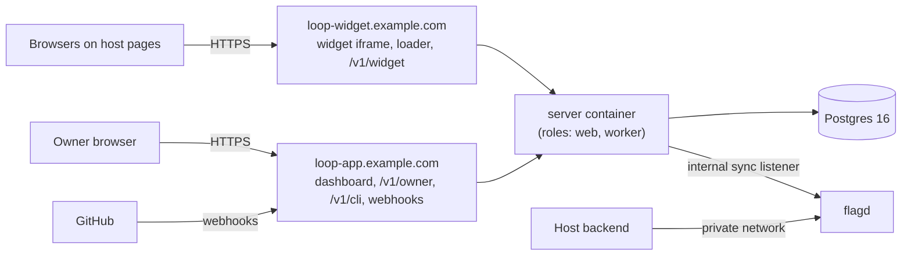

# 10. Cross-Cutting Concerns

## 1. Observability

Self-hosted first, so everything is local to the owner's install and nothing phones home.

**Logs.** Structured JSON (pino) carrying `request_id` (the `req_` ID), `x_request_id`,
`site_id`, `actor_type`, and `event`. A redaction allowlist approach: fields are logged only if
listed. Request text, specs, tokens, assertions, and `sub` are never logged (SR-14, ST-20, with a
log-scan test in CI). `sub` appears only as a keyed hash.

**Metrics** (Prometheus `/metrics` on the **internal listener only**, never the public hostnames,
plus a dashboard health page). No metric has a `request_id` or `sub` label, enforced by a lint
over metric definitions (ST-60), because per-request hold counts are hold data. Hosted mode
isolates metrics per tenant (SR-34).

| Metric | Why |
|--------|-----|
| `requests_by_state{state}`, `request_state_age_seconds{state}` (histogram) | Stuck requests: `merged` age catches R7; `paused_rate_limited` age catches R4 |
| `transitions_total{from,to,actor_type}`, `invalid_transition_total{event}` | Drift, client bugs, attack probing |
| `precheck_verdict_total{checkpoint,layer,verdict}`, `precheck_flag_rate{site}` | PC2: the false-positive budget (target < 3%) |
| `holds_cleared_total`, `hold_clear_latency_seconds` | Fatigue signal: fast clears are a smell |
| `outbox_pending`, `outbox_dead_total{effect}`, `outbox_attempts` | Effect health |
| `notifications_sent_total{kind,channel}`, `notifications_suppressed_total{kind}`, `notification_policy_version{site}` | Tuning the decision-30 policy (`14` §4); a sudden jump in suppressions after a policy change is visible |
| `webhook_rejected_total{reason}` | Forged or replayed webhooks |
| `token_mints_total{kind}`, `push_token_refused_total{reason}` | T7.2 detection |
| `intake_llm_spend_usd{site}` (Phase 2) | The SR-30 hard cap |
| `cli_requests_total{cli_version}`, `sdk_requests_total{sdk,version}` | The deprecation prerequisite (`05` §4) |
| `rate_limited_runs_total`, `run_duration_seconds{phase}` | Subscription fit (R4) |

**Tracing.** OpenTelemetry spans around transitions, outbox effects, and GitHub calls. The OTLP
exporter is off by default.

**CLI telemetry.** None is sent anywhere except the run results it reports to the owner's own
server. Run logs stay local in `~/.soren-loop/runs/<run_id>/`, with stream lines redacted.

**Alerts** go through the notification policy (`14`). Locked: `security_hold_entered`,
`precheck_unavailable`, App permission-check failure, outbox `dead`, `policy_changed`,
`audit_chain_mismatch`, `authenticator_changed`, `cli_device_approved`, and
`owner_contact_changed`. Tunable: a request in
`merged` for more than 7 days, and the flag-rate threshold for a requester (sent once). Project
CI alerts (a policy-diff issue opened, a webhook signature-failure spike) go to maintainers or
to metrics, not through the policy.

## 2. Deployment for Self-Hosters (decision 18: two hostnames)

- **One image** (`ghcr.io/sorenai-dev/soren-loop-server@sha256:...`, signed) runs as `--role=web`
  and `--role=worker` (two processes or one with both). Plus Postgres and flagd. A
  `docker-compose.yml` and a reverse-proxy example (Caddy) for the two hostnames ship in the
  repo.
- **Hostname rules.** The two hostnames must be different hosts. The widget host must **not**
  be a subdomain of the dashboard host, because the dashboard host is the WebAuthn RP ID
  (`06` §3). Example: `loop-app.example.com` and `loop-widget.example.com`. Using sibling hosts
  under one registrable domain is fine. The routing layer serves only the widget routes on the
  widget host. A startup self-check refuses to boot if the two configured hostnames are equal,
  or if the widget host is a subdomain of the dashboard host.
- **Origin scoping (SR-29).** Sibling hosts are same-site, so the dashboard host enforces an
  exact `expectedOrigin` for WebAuthn, plus `Sec-Fetch-Site: same-origin`, an exact `Origin`, and
  CSRF on every state-changing route, and reads only `__Host-` cookies (`06` §3).
- **GitHub App start-up check.** The server verifies both Apps' permissions and installed repos
  at boot and hourly, and fails closed on anything extra (`08` §1.4a, T10.12).
- **Headers.** Dashboard: nonce CSP, Trusted Types, `frame-ancestors 'none'`, HSTS. Widget:
  `frame-ancestors <the site's registered origins>`, set per site from config.
- **Secrets.** `SL_MASTER_KEY` (the envelope key) comes from the environment or a file. The two GitHub App
  private keys are separate `0400` files in `SL_SECRETS_DIR`, written once by `--setup` and mounted read-only afterwards
  (`08` §1.5). None of these is ever stored in Postgres.
- **The flagd sync listener** binds to localhost or a private network only (`16` §2).
- **GitHub App creation.** Two Apps (decision 25), each registered through a manifest flow from the dashboard setup wizard, plus a bot-only org for the fork (`08` §1.3). The manifests are checked into
  Repo 1 under CODEOWNERS (SC8). `doctor` diffs each App's installed permissions against its manifest.
- **Backups.** A standard `pg_dump`. The receipts and the audit chain are inside it.

## 3. Cost

| Cost | Who pays | Shape | Controls |
|------|----------|-------|----------|
| `plan`, `build`, and L1 pre-checks | The owner's Claude subscription (or API key in API-key mode) | Per request: one L1 call at PC-A, one at PC-B, one plan run, one or more build runs with a Zod review at every phase boundary. **UNVERIFIED** how many medium features fit in a Pro five-hour window (discovery: "a large share"). | Owner-started builds (decision 6); `max_review_rounds = 3`; turn and wall-clock caps; `paused_rate_limited`; docs recommend Max or Ultra for regular use |
| Intake LLM (Phase 2) | The owner's API key | Haiku-class, a handful of turns per request (**UNVERIFIED** per-request cost; discovery estimates cents) | Monthly hard cap with fallback to form mode; per-`sub` caps |
| Infrastructure | The owner | One small container, Postgres, flagd. Under 1 vCPU and 1 GB RAM at MVP volumes (estimate). | — |
| Email | The owner's SMTP | Digests after N per hour | SR-11 |
| GitHub | Free | API calls within App rate limits | Outbox backoff |

The **binding constraint is the owner's subscription quota and attention**, not infrastructure.
That shapes the 10x analysis in `12` §3.

## 4. Rollback

| What | How |
|------|-----|
| A bad feature after rollout | `kill_flag` (no step-up: the safe direction) sets the flag off within one flagd poll interval (**UNVERIFIED** latency, S4). Then a normal revert PR, owner-authored. |
| A bad server release | Images are immutable and digest-pinned, so the rollback is to the previous digest. DB migrations are expand/contract (`05` §4), so the previous release runs against the newer schema for one release. Every migration ships its `down` and is tested in CI. |
| A bad CLI release | `npm i -g soren-loop@<previous>`. The server's `X-SL-Min-CLI` is raised only in a server release, never by itself, so old CLIs keep working until the owner upgrades the server. |
| A bad vendored prompt (tdd-pair or personas) | Revert the vendor-sync PR and release the CLI. Because prompts are pinned and never fetched, a bad upstream change never reaches an owner without a CLI release (SC3). |
| A bad request mid-flight | `reject` works from every waiting state, and from `security_hold`. A running CLI's next call fails with `invalid_transition`, and the lease is revoked. |
| A wrong flag write | `FlagWriter` writes are absolute. Replaying the DB's intended state (`flag.reconcile` effect) restores correctness. |
| The policy changes (Anthropic) | Decision 29 (Q5): a maintainer decision within 72 hours, with a pre-written advisory, never an automatic switch. The API-key path is first-class (R1). The CLI's `--auth api-key` mode needs no code change in the control plane. |

**Reconciler** (nightly, plus on demand from the dashboard). It compares GitHub PR state with
request state and the flag store's state with the `flags` table. It repairs flag drift by
replaying, and **reports** request drift to the owner instead of auto-transitioning. Auto-repair
of state would be the system acting without a deterministic event.

## 5. Weekly Anthropic Policy-Diff Job (decision 13)

- **Where:** `.github/workflows/policy-diff.yml` in Repo 1 (the project's own CI, not the
  owner's install), scheduled weekly plus `workflow_dispatch`. Actions are SHA-pinned.
  `permissions: {contents: read, issues: write}` only (SC10).
- **What it watches:** the pages cited in `01-discovery.md` §Q1: Claude Code
  legal-and-compliance (authentication and credential use; offering Claude Code in products;
  acceptable use), the Agent SDK overview note, the Help Center login article, the
  authentication docs (`setup-token`), the GitHub Actions docs, and the Consumer Terms for the
  EU question. The URL list lives in `policy/watched-pages.json`.
- **How:** fetch, extract main text, normalize whitespace, and hash per section. Compare with
  `policy/snapshots/*.txt` committed in the repo. On a change, open (or update) one issue titled
  `Anthropic policy text changed: <page>` with a unified diff, labelled `policy-review`. It
  never feeds fetched content to an agent with tools. Snapshot updates are a human PR.
- **What it gates:** the release checklist requires zero open `policy-review` issues, or an
  explicit maintainer sign-off comment on each. A fetch failure opens a `policy-fetch-failed`
  issue instead of passing silently.
- **Cost of the alternative** (a monthly manual read): drift goes unnoticed for weeks, while R1
  is the highest-impact risk on the register.

## 6. Testing Strategy

| Level | What | Notes |
|-------|------|-------|
| Unit (most) | Transition table guards; normalization and hashing (golden vectors shared by server and CLI); challenge derivation; L3 rules; the SR-04 policy engine; the outcome validator (fixtures from the kit's tests); flagd rendering | Table-driven; the SR-04 deny-list test is generated from the list itself |
| Property | ST-23: random event sequences against real Postgres | fast-check; runs in CI on every PR |
| Contract | `@sorenai/loop-schema` JSON Schema snapshots; CLI-to-server API contract tests; `stream-json` fixtures per supported Claude Code version | A schema change fails CI until the snapshot is updated in review |
| Integration | Webhook verification and dedup; both GitHub Apps against a sandbox org (the S1 scripts become regression tests, plus ST-48 and ST-49); WebAuthn with a virtual authenticator (Playwright) | ST-06, ST-13, ST-14, ST-16 |
| Security (negative) | ST-01 to ST-40, each tagged with its SR | The release gate: every MUST-MVP ST green |
| Red test | S7: ST-01 to ST-03 against the real sandbox image on macOS and Linux runners | Builds are disabled if any probe succeeds |
| E2E | The `02` §7 smoke test, nightly, against the demo app | The definition of Phase 1 done |
