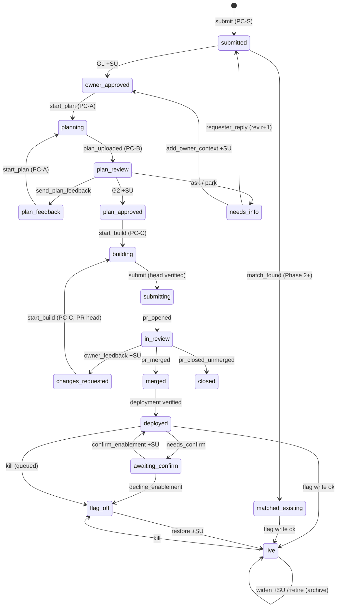
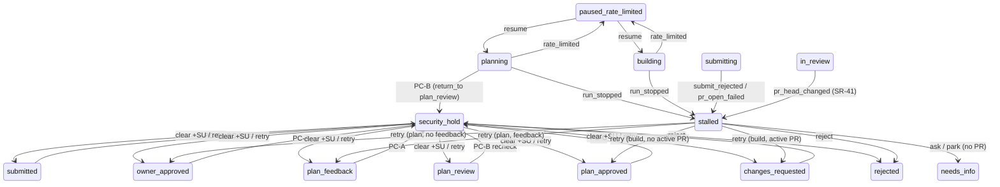

# 18. State Machine Diagrams

These diagrams illustrate the table in `03` §3. They aren't normative: where they differ, the
table wins. The `reject` edges from every state in P, and the `withdraw` edges to `closed`, are
left out to keep the diagrams readable (`03` rows 4 and 33).

## 1. Main Lifecycle

`building`, `submitting`, `deployed`, and `awaiting_confirm` are sub-states (`03` §2). `live`
stands for the set L.

## 2. Holds, Pauses, Stalls

