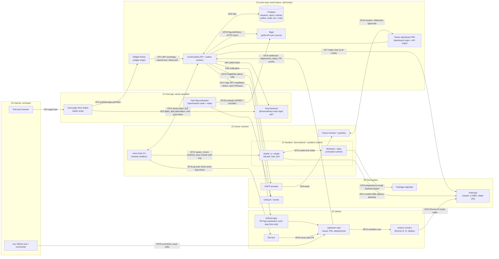

e# Threat Model 01: System Model, Assets, and Trust Boundaries

Author: Sentinel · Date: 2026-10-30 · Status: Draft for owner review
Inputs: `docs/discovery/00` to `03`. Index: `threat-model.md`.

---

## 1. Scope

**In scope (V1 design, self-hosted):** embeddable widget (loader plus iframe), host-app SDKs
(`@sorenai/loop-node`, `@sorenai/loop-react`), control-plane API, Postgres, outbox workers,
owner dashboard, email notifier, flagd sync and the Unleash `FlagWriter`, GitHub App (fork
model), owner CLI and Claude Code plugin, the sandbox the CLI starts (devcontainer plus
worktree, or the sandbox-runtime fallback), Runner B (Claude Code Action), intake LLM mode
(owner API key), and release and distribution of everything we publish.

**Future scope, analysed separately:** the hosted orchestration platform (`05`).

**Out of scope:** Anthropic's and GitHub's own infrastructure; the host app's own security,
except where its keys and evaluation context feed us; vulnerabilities in code the owner writes
by hand.

### Working assumptions (if any of these is wrong, the model is wrong)

| # | Assumption | Source |
|---|------------|--------|
| A1 | The owner's repo is private, or public with outside contributors. Both are supported, and public is the harder case. | Not stated. **Open question Q1** |
| A2 | One owner or a small trusted team. The same person can approve a spec and merge the PR. | Brief (single-owner language) |
| A3 | The requester never sees a plan, a diff, a repo name, or a PR link. | Brief, "coarse stages only" |
| A4 | Builds start only when the owner runs a command (no daemon). | Decision 6 |
| A5 | Every request is hostile. Every end user can be an attacker, because sign-up on the host app is cheap. | Sentinel's stance |
| A6 | Whenever the request is malicious, the build agent is compromised. Prompt injection is not a solved problem, so no control here depends on the model refusing. | Sentinel's stance |

---

## 2. Assets

| ID | Asset | Class | Where it lives | Why an attacker wants it |
|----|-------|-------|----------------|--------------------------|
| AS1 | **Integrity of the owner's default branch** (code that ships to every user) | Restricted | GitHub upstream | Backdoor, data theft from all of the host app's users. The crown jewel. |
| AS2 | Owner's Claude credential: `/login` session or a one-year `setup-token` | Restricted | Owner machine or container volume; owner repo secret (Runner B) | Free inference on someone else's plan; the owner's account gets suspended |
| AS3 | Intake LLM API key (owner's Anthropic key) | Restricted | Backend config | Spend, and abuse attributed to the owner's account |
| AS4 | GitHub App private key and installation tokens | Restricted | Backend | Opens PRs and issues on the owner's repos; writes to the fork |
| AS5 | Flag-vendor management credentials (Unleash admin or API token) | Restricted | Postgres, encrypted | Turns any flag on for everyone, including non-soren-loop flags |
| AS6 | Flag state: who sees which feature | Confidential | Postgres, flagd, vendor | `enableAll` on a half-built feature; reading the roadmap |
| AS7 | Owner authenticators, dashboard sessions, CLI tokens | Restricted | Owner devices, DB (hashed), OS keychain | Approving the attacker's own spec; minting push tokens |
| AS8 | Requester PII: `sub`, display name, request text | Confidential | Postgres, email, GitHub issue, LLM provider | Privacy breach, harassment, doxxing |
| AS9 | Host JWT signing key (host-held); site JWKS configuration | Restricted | Host backend; Postgres | Impersonating any end user |
| AS10 | The owner's machine beyond the worktree: `~/.ssh`, `~/.aws`, `~/.claude`, browser profile, other repos | Restricted | Owner workstation | Full developer compromise |
| AS11 | Unreleased roadmap: request titles, specs, flag keys | Internal/Confidential | DB, issues, client bundles, OFREP | Competitive intelligence |
| AS12 | Owner attention, subscription quota, API spend | Operational | — | DoS that costs no infrastructure |
| AS13 | Trust in what we distribute: CLI, plugin, personas, SDKs, server image, widget loader | Restricted | npm, plugin marketplace repo, container registry, control-plane origin | One compromise reaches every owner (and every host page) |
| AS14 | **The sorenai.dev brand and its shared accounts.** soren-loop ships under the owner's security-audit brand (Soren Score), using the `sorenai-dev` GitHub account, the `@sorenai` npm scope, and the `sorenai.dev` domain. | Restricted | GitHub, npm, DNS registrar | A soren-loop compromise or a public vuln damages the audit business out of proportion. A security brand is a trophy target. Shared accounts couple the blast radius across the suite. |

---

## 3. Actors

| Actor | Trust | Notes |
|-------|-------|-------|
| End user / requester | **Untrusted** | Authenticated by the host app; that proves identity, not intent |
| Host app (frontend) | Semi-trusted | Its XSS is outside our control; its compromise means it can impersonate its own users |
| Host app (backend) | Trusted for identity assertions only | Holds the signing key |
| Owner (dashboard, CLI) | Trusted principal | Can be phished, fatigued, or socially engineered |
| Repo collaborators | Partially trusted | Can edit issues and comment; may be able to merge |
| Any GitHub user | Untrusted | Can comment on public issues and PRs, and open fork PRs |
| Build agent (`claude -p` with the tdd-pair skill) | **Untrusted output, privileged position** | "Agent on behalf of owner for request R". Not the owner. |
| Intake LLM | Untrusted output | Phase 2, API-key mode only |
| Dependency authors (target repo) | Untrusted | Code runs inside the sandbox during build and test |
| Our release pipeline and maintainers | Trusted, high value | Supply-chain target |

---

## 4. Data-Flow Diagram

Trust boundaries are the subgraph edges. Every arrow that crosses one is analysed in `02`.

---

## 5. Trust Boundaries

| TB | Boundary | Flows | What changes across it |
|----|----------|-------|------------------------|
| TB1 | Host page ↔ widget iframe | DF2 | Host-origin JS (untrusted to us) ↔ widget origin holding the session token |
| TB2 | Host backend ↔ control plane | DF4 (JWT), DF5 | A host identity assertion becomes a soren-loop session; we fetch a host-supplied URL (SSRF) |
| TB3 | Widget / API ↔ intake LLM | DF7 | Untrusted text in, untrusted structured output back (Phase 2) |
| TB4 | Control plane ↔ Postgres | DF6 | Every secret and every hash lives here |
| TB5 | Owner browser ↔ dashboard | DF10 | Approval authority; attacker-controlled request content is rendered next to the passkey ceremony |
| TB6 | Control plane → email → owner inbox | DF8, DF9 | Attacker-controlled text reaches the owner over a trusted channel |
| TB7 | Control plane ↔ owner CLI | DF11 | Server-held state becomes instructions on the owner's machine; CLI credentials can mint GitHub tokens |
| TB8 | CLI → sandbox → `claude -p` → Anthropic | DF12, DF14, DF15 | The owner's machine and credentials ↔ an agent that must be assumed compromised |
| TB9 | Repo and dependency content → agent context | DF13 | Data becomes instructions (indirect injection) or execution (hooks, scripts) |
| TB10 | Control plane / CLI ↔ GitHub | DF16 to DF21 | App key custody; webhooks are inbound and attacker-reachable; fork → upstream |
| TB11 | Control plane ↔ flag store ↔ host evaluation | DF23 to DF25 | Who sees the feature; flags evaluated in browsers are public |
| TB12 | Control plane → requester status feed | DF4 (poll) | Internal state → an untrusted viewer |
| TB13 | Our releases → owner machines and host apps | npm, marketplace, registry, loader | Everything we ship runs with the owner's or host's privileges |

---

## 6. Data Flows Needing Explicit Protection

| Flow | Data | Protocol | AuthN | Integrity / confidentiality requirement |
|------|------|----------|-------|------------------------------------------|
| DF4 | JWT; widget session; request text | HTTPS | Host JWT → session token bound to `(site_id, sub)` | TLS; token only in iframe memory; request size caps |
| DF5 | JWKS | HTTPS (outbound) | n/a | SSRF controls; cache; HTTPS only |
| DF10 | Approvals | HTTPS + WebAuthn | Session + UV assertion | Challenge bound to the content hash (`02` TB5, `06` SR-05) |
| DF11 | Approved request/spec + hashes; plan upload; push-token mint | HTTPS | CLI access token (device flow) | Hash verification on the CLI; mint authorised by request state |
| DF12 | Worktree mount; Claude auth only | Local | n/a | No other env, mounts, or sockets |
| DF14 | Prompts, file contents | HTTPS | Owner's Claude auth | Only egress in the sealed phase |
| DF16 | Commits | git over HTTPS | One-hour push-App token, fork only (decision 25) | Minted per submit, never inside the sandbox |
| DF19 | Webhooks | HTTPS (inbound) | `X-Hub-Signature-256` HMAC | Constant-time verify; dedup on `X-GitHub-Delivery` (GitHub signs the body only, with no timestamp, so replay is possible) |
| DF23 | Flag documents with user-ID lists | HTTP sync | **UNVERIFIED** whether flagd can send an auth header (spike S4) | Not reachable from the internet |
| DF24 | Vendor admin calls | HTTPS | Vendor token, scoped to project and environment | Decrypted only in the outbox worker |
